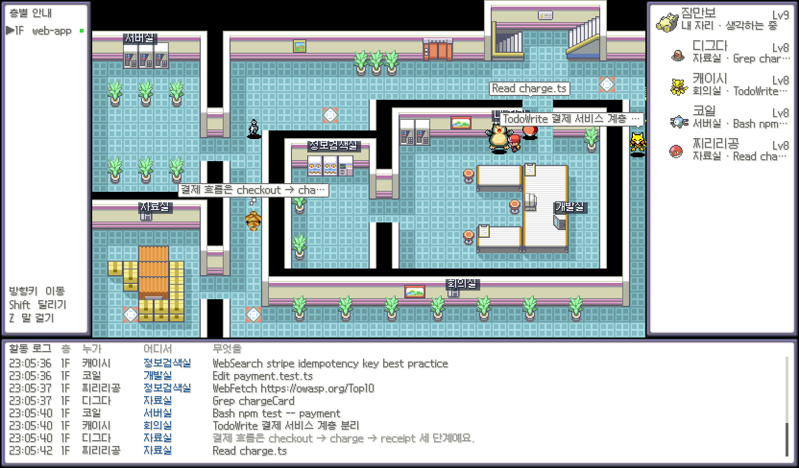

# poke-agents-office

Claude Code가 터미널에서 뭘 하고 있는지 한눈에 보는 로컬 대시보드.
세션 하나하나가 **파이어레드 실프주식회사**에서 일하는 1세대 포켓몬이 된다.



- 파일을 읽으면 자료실로, 명령을 돌리면 서버실로, 코드를 고치면 개발실로 걸어간다.
- 서브에이전트를 부르면 자리에서 전화를 걸고, 지원 포켓몬이 엘리베이터를 타고 출근한다.
- 도구를 쓸 때마다 레벨이 오르고, 원작 레벨에 닿으면 진화한다.
- 설치할 것도, 훅 설정도 없다. Claude Code가 남기는 세션 기록(`~/.claude`)을 읽기만 한다.

## 빠른 시작

Node.js 18 이상이 필요하다. 의존성은 없다.

```sh
git clone https://github.com/hexdrinker/poke-agents-office.git
cd poke-agents-office
node server.js          # → http://127.0.0.1:7777
```

Claude Code 세션이 하나라도 켜져 있으면 바로 출근해 있다. 처음 열 때만 게임 그래픽을 내려받느라 몇 초 걸린다.

### 데모 (Claude Code 없이)

```sh
./demo.sh               # 프로젝트 두 개(두 층) + 서브에이전트 1마리
./demo.sh team          # 한 세션이 서브에이전트 4마리를 동시에 부르는 장면
OPEN=1 ./demo.sh team   # 브라우저까지 자동으로 열기
```

임시 폴더에 가짜 `~/.claude`를 만들어 기록을 흘려 넣고 http://127.0.0.1:7778 에서 보여 준다. 실제 데이터 경로를 그대로 탄다.

### 환경 변수

| 이름 | 기본값 | 설명 |
|---|---|---|
| `PORT` | `7777` | 서버 포트 |
| `CLAUDE_DIR` | `~/.claude` | 읽을 Claude Code 데이터 폴더 |

## 화면

| 영역 | 내용 |
|---|---|
| 층별 안내 (왼쪽) | 프로젝트마다 한 층. 일하는 층엔 초록불, 누르면 `▲ 3F` 엘리베이터로 이동 |
| 사무실 (가운데) | 그 층에서 일하는 포켓몬들과 트레이너(나) |
| 파티 (오른쪽) | 그 층의 세션과 서브에이전트, 레벨, 상태(SLP·PAR), 어디서 무엇을 하는지 |
| 활동 로그 (아래) | 시각 · 층 · 누가 · 어디서 · 무엇을. 최신이 아래, 휠로 스크롤 |

창 크기에 맞춰 커지고, 2배·3배처럼 정수 배율이 들어갈 땐 거기에 맞춘다. 가장 선명한 건 2배(1664×976)로, 브라우저 창이 약 1700×1010 이상이면 된다.

## 사무실

층마다 실프주식회사의 실제 다른 층 지도를 쓴다(5F → 3F → 2F → … 순으로 배정).
방은 그 층에 실제로 있는 설비를 찾아 자동으로 배치한다.

| 방 | 설비 | 하는 일 | 연출 |
|---|---|---|---|
| 자료실 | 설계도·카운터 | Read / Grep / Glob | |
| 개발실 | 컴퓨터 | Edit / Write | 화면에 코드가 흐름 |
| 서버실 | 깜빡이는 장비 | Bash | 실행 중엔 LED가 빨라짐 |
| 정보검색실 | 장비·컴퓨터 | WebSearch / WebFetch / MCP | 모니터 스캔라인 |
| 회의실 | 설계도·카운터 | TodoWrite / Task* / 플랜 모드 | |
| 내 자리 | 전화 | 질문, 응답 끝, 서브에이전트 호출 | |

- 생각하는 동안엔 Claude가 쓴 글 요약이 구름 말풍선으로 뜬다.
- 도구가 실패하면 식은땀과 빨간 말풍선, "그러나 실패하고 말았다!"
- 질문(AskUserQuestion)이 생기면 자기 자리로 돌아가 `!`와 PAR 상태로 기다린다.
- 세션이 끝나면 "돌아와, 피카츄!" 하고 몬스터볼로 들어간다. `/clear`는 같은 프로세스라 같은 포켓몬이 이어서 일한다.

### 서브에이전트

자리에서 전화 → 엘리베이터로 출근 → 각자 방에서 일함 → 부른 포켓몬 옆에서 "보고드립니다!" → 몬스터볼로 귀환.

| 종류 | 포켓몬 |
|---|---|
| Explore | 디그다 → 닥트리오 |
| Plan | 캐이시 → 윤겔라 → 후딘 |
| general-purpose | 코일 → 레어코일 |
| 그 밖 | 캐터피, 뿔충이, 꼬렛, 주뱃, 알통몬, 꼬마돌, 야돈, 잉어킹, 이브이… 1세대 30종 중 화면에 없는 친구 |

## 포켓몬과 진화

세션은 이상해씨, 파이리, 꼬부기, 피카츄, 잠만보, 구구, 고오스, 미뇽, 고라파덕, 나옹, 푸린 중 하나가 된다.
같은 Claude Code 프로세스면 늘 같은 포켓몬이고, 동시에 떠 있는 세션끼리는 겹치지 않는다.

레벨 = Lv5 + 도구 호출 수. 원작 진화 레벨에 닿으면 FRLG처럼 "어라…!?" 하며 진화한다
(이상해씨·파이리·꼬부기 16, 구구 18, 잉어킹 20, …). 돌·통신교환 진화는 원작에 레벨이 없어 임의 레벨을 쓴다.

## 트레이너

파이어레드 주인공(레드)이 나다.

| 키 | 동작 |
|---|---|
| 방향키 / WASD | 걷기 |
| Shift | 달리기 |
| Z / Space / Enter | 앞의 포켓몬에게 말 걸기 (지금 하는 일을 알려 준다) |

Claude Code에 메시지를 보내면 트레이너가 그 세션의 포켓몬에게 걸어가 말을 건다. 다른 층이면 엘리베이터를 타고 간다.

## 동작 원리

```
~/.claude/sessions/*.json          살아 있는 Claude Code 프로세스 (pid, sessionId, cwd)
~/.claude/projects/**/<id>.jsonl   대화 기록: 도구 호출·결과, 응답, end_turn
   └ <id>/subagents/agent-*.jsonl  서브에이전트 기록 (+ meta.json 의 toolUseId 로 부모 호출과 연결)
        │  0.25초마다 새로 붙은 줄만 읽음
        ▼
server.js ── SSE /events ──▶ index.html (캔버스 하나에 GBA 해상도로 그린 뒤 확대)
   └ /pret/*, /pmd/*  게임 그래픽 프록시 + .cache/ 에 저장
```

- 서버를 켜기 전부터 돌던 세션은 지금까지의 도구 호출 수로 레벨을 맞추고, 최근 30개 이벤트만 다시 보여 준다.
- 지도는 pret 디컴프의 타일셋·메타타일·충돌·동작(behavior) 데이터를 브라우저에서 직접 디코딩해 그린다. 포켓몬은 충돌 데이터를 따라 길을 찾아 걷는다.
- 서버는 `127.0.0.1`에만 열리고 Host 헤더를 검사한다. 세션 기록은 내 브라우저로만 간다.

## 에셋과 저작권

게임 그래픽은 이 저장소에 들어 있지 않다. 처음 실행할 때 원래 저장소에서 내려받아 `.cache/`(git 제외)에 저장하고, 그다음부턴 오프라인으로 돈다.

| 에셋 | 출처 | 라이선스 |
|---|---|---|
| 지도·대사창·메뉴·아이콘·트레이너 | [pret/pokefirered](https://github.com/pret/pokefirered) | — |
| 포켓몬 맵 스프라이트(걷기·대기·잠) | [PMDCollab/SpriteCollab](https://github.com/PMDCollab/SpriteCollab) | CC BY-NC 4.0, 각 작가 |
| 폰트 Galmuri11 / Galmuri9 (`vendor/fonts`) | [quiple/galmuri](https://github.com/quiple/galmuri) | SIL OFL 1.1 |

Pokémon과 관련 그래픽의 권리는 Nintendo / Game Freak / The Pokémon Company에 있다.
이 프로젝트는 비공식·비상업 팬 프로젝트이며 위 회사들과 관계가 없다.

## 한계

- 권한 승인 대기는 기록에 남지 않아 감지하지 못한다. 질문 도구(AskUserQuestion)만 잡는다.
- 생각(thinking) 내용은 기록에서 비어 있어, 구름 말풍선엔 도구 사이에 쓴 글을 대신 띄운다.
- 서버를 켜기 전부터 돌던 서브에이전트는 다음에 뭔가를 할 때 나타난다.
- 실프 층 중 설비가 적은 작은 층(10F·11F)은 일부 방이 복도에 놓인다.
